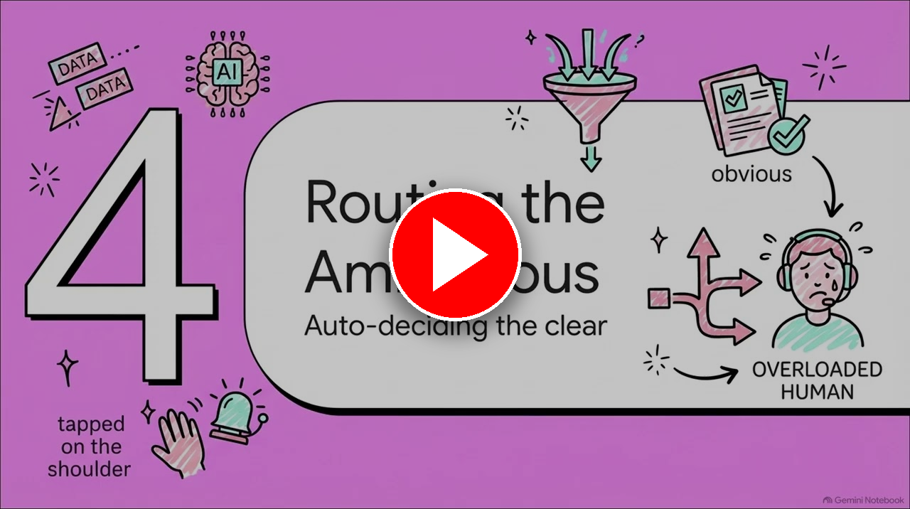
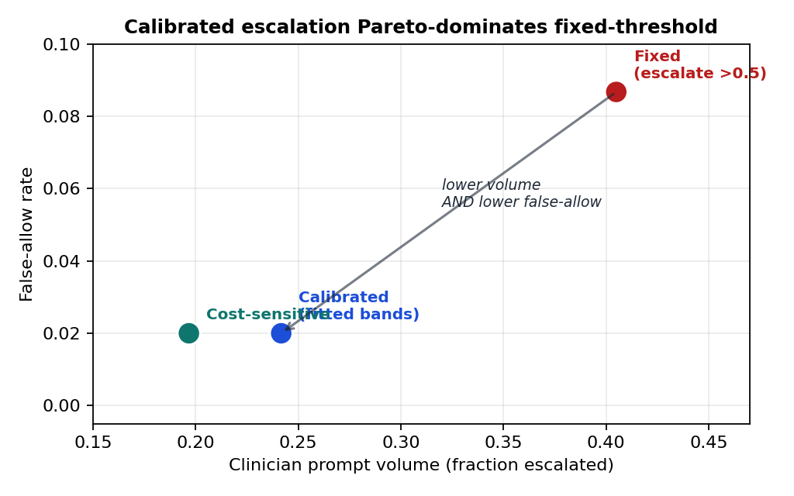
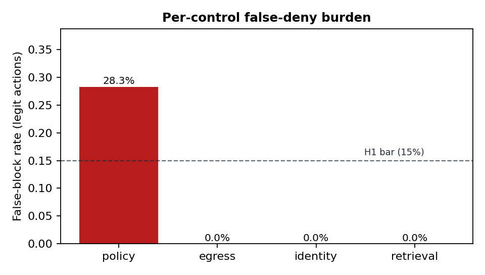
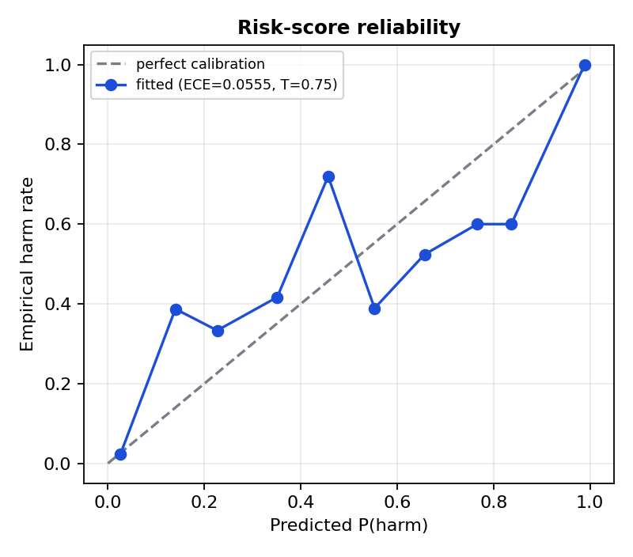
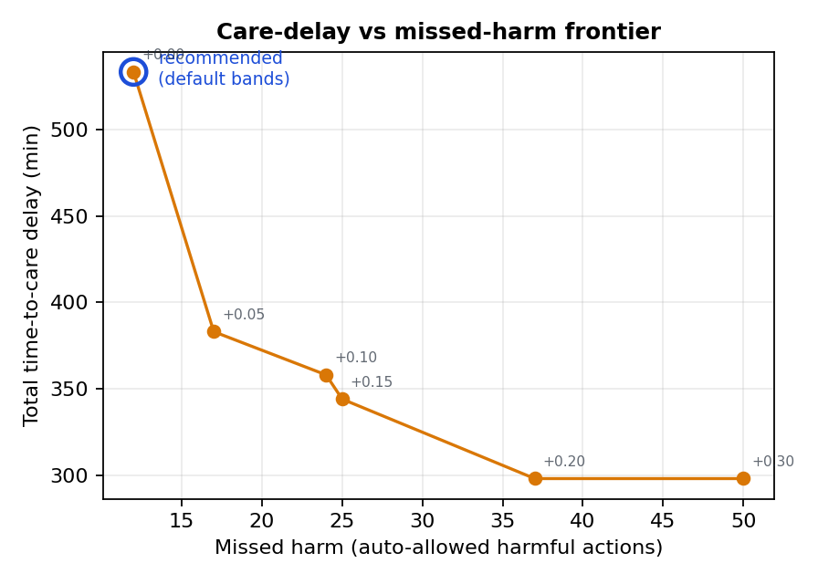
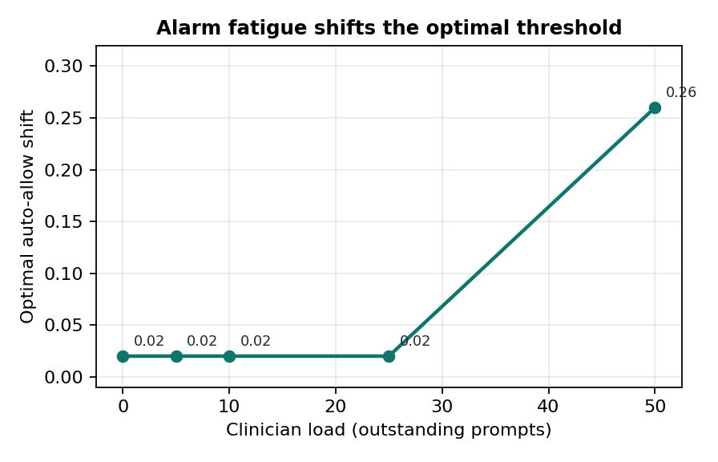

<div align="center">


### Risk-calibrated escalation routing that sends only genuinely ambiguous agent actions to clinicians


[](https://huggingface.co/datasets/Quome/triagebench)

[**Quickstart**](#quickstart) · [How it works](#how-it-works) · [Reproduce](#reproduce-the-experiments) · [Results](#headline-results) · [Paper](papers/009-hitl-calibration/main.pdf) · [Dataset](https://huggingface.co/datasets/Quome/triagebench) · [Cite](#cite)

</div>

---

Every upstream guardrail in a clinical AI gateway answers a binary allow/block question, and strict enforcement over-blocks: the policy control alone false-denies 28.3% of legitimate actions, which is a real care-delay hazard and a source of alarm fatigue. The oversight layer sits last in the qfire request path, aggregates every prior layer's confidences and deny-reasons into a calibrated risk score, and routes auto-allow / auto-deny / escalate behind a park-notify-resume-timeout primitive that fails closed. On TriageBench (600 synthetic clinical actions with three-rater labels, Fleiss kappa 0.81), fitting the risk model cuts calibration error from 0.229 to 0.056, and the calibrated router Pareto-dominates a fixed threshold: 40% fewer clinician prompts (0.405 to 0.242) at lower false-allow (0.087 to 0.020). The pre-registered 60% volume target was not reached and is reported as-is.

<div align="center">

[](https://youtu.be/I7d2Vh6Mudk)

**▶ Watch: [Qutriage: Calibrating Human Oversight for Clinical AI Agents (talk)](https://youtu.be/I7d2Vh6Mudk)**

</div>

`qutriage` is **a module of the QUOKKAGUARD program**: one Rust security gateway (`qfire`) that sits in front of any OpenAI-compatible model endpoint and decides **ALLOW ▸ forward · BLOCK ▸ refuse · ESCALATE ▸ human review** for every request and response. Each module adds exactly one enforcement layer to that gateway plus one adversarial dataset and one paper. This repository is a self-contained snapshot of the gateway with **this layer** (`src/oversight/`, on the *escalate* path, HAARF control C4), its dataset (**TriageBench**), the experiment harness, and the paper.

> Everything here runs **offline**: no model API keys, no network calls in the experiments.

## How it works

- **Signal contract** - a single `OversightSignals` struct with reserved `Option` slots is populated independently by each upstream layer; adapters map real decisions (policy effects, retrieval trust tier, identity checks, egress findings) into [0,1] risk inputs, so absent layers contribute nothing and the layer degrades gracefully.
- **Calibrated scorer** - risk = sigmoid(logit / temperature), a weighted logit over the signals fit offline on TriageBench by deterministic logistic regression plus grid temperature scaling (T = 0.75, block-confidence weight 9.85 dominant); the fitted weights ship as `Calibration::default()` and a unit test asserts the shipped defaults match the committed config.
- **Per-class escalation bands** - the router maps risk and tool-risk class onto (allow_below, deny_above) bands: low [0.25, 0.80], high [0.12, 0.90], life_critical [0.06, 0.95]; below auto-allow, above auto-deny, in between escalate, so higher-risk tools escalate a wider middle.
- **Real escalation primitive** - on escalate the gateway mints an audited `EscalationTicket`, parks the request, notifies a `HumanChannel` (a production `WebhookChannel` with a `/resolve/{id}` endpoint, or an `OracleChannel` driven by TriageBench labels in experiments), resumes on the clinician's answer, or fires a fail-closed timeout defaulting to auto-deny.
- **Load-aware throttle** - the alarm-fatigue mechanism raises the auto-allow threshold as outstanding prompts accumulate; the utility-optimal auto-allow shift moves from 0.02 at low load to 0.26 at load 50, so static thresholds are mis-set.

## Quickstart

Requires Rust 1.85+ (`rustup`), Python 3.10+ for the analysis scripts, and `tectonic` (or `pdflatex`) only if you want to rebuild the paper.

```bash
git clone https://github.com/quome-cloud/qutriage
cd qutriage
cargo build --release
cargo test --lib oversight --test oversight_escalation   # this layer's tests
```

Then see the layer in action:

```bash
# All experiments are offline Python (no Ollama, no API keys); run from the repo root.
# TriageBench and the fitted calibration are tracked; regenerate them (seed 42) if you like:
python3 scripts/009-hitl-calibration/gen_triage.py        # -> datasets/009-hitl-calibration/triagebench/
# TriageBench: 600 actions | ...
python3 scripts/009-hitl-calibration/fit_calibration.py   # -> datasets/009-hitl-calibration/calibration_fitted.json
# fitted logistic: train acc=... ECE(T=0.75)=0.056...

# Run E1-E6 plus Fleiss' kappa (seconds):
python3 scripts/009-hitl-calibration/run_experiments.py
# E2 calibration: ECE 0.229 -> 0.056 (T=0.75)
# E3 H2: fixed vol=0.405 -> calibrated vol=0.242 (40% reduction; FA fixed=0.087 cal=0.02; target_met=False)
# E6 end-to-end: FA=0.02 FB=0.005 OE=0.242 TTC=533min
# Fleiss kappa: 0.81
# wrote results/009-hitl-calibration/{e1..e6,kappa}.json

# Exercise the Rust layer (scorer, router, park/resume/timeout, Rust/Python calibration parity):
cargo test --lib oversight --test oversight_escalation
```

## Reproduce the experiments

Every number in the paper traces to one of these runs (95% Wilson CIs, deterministic seeds, pinned model snapshots). Run outputs land in `results/009-hitl-calibration/` (not tracked; see [`results/009-hitl-calibration/README.md`](results/009-hitl-calibration/README.md) for the exact regeneration commands).

| Exp | What it measures | Needs |
|---|---|---|
| E1 | Per-control false-deny burden: deny/escalate/false-block rate of each upstream control treated as an enforcer | offline |
| E2 | Risk-score reliability diagram and ECE before/after temperature scaling | offline |
| E3 | Escalation policy comparison: volume vs false-allow for fixed-threshold, calibrated, and cost-sensitive routing | offline |
| E4 | Care-delay frontier: total time-to-care delay vs missed harm across auto-allow shifts | offline |
| E5 | Alarm-fatigue model: utility-optimal auto-allow shift as a function of clinician load | offline |
| E6 | End-to-end FA/FB/OE/TTC at the recommended config, plus Fleiss' kappa over the TriageBench labels | offline |
| figures | Regenerate figs/*.png from the result JSON | offline |

```bash
# E1 — Per-control false-deny burden: deny/escalate/false-block rate of each upstream control treated as an enforcer
python3 scripts/009-hitl-calibration/run_experiments.py   # writes results/009-hitl-calibration/e1.json

# E2 — Risk-score reliability diagram and ECE before/after temperature scaling
python3 scripts/009-hitl-calibration/fit_calibration.py && python3 scripts/009-hitl-calibration/run_experiments.py   # e2.json

# E3 — Escalation policy comparison: volume vs false-allow for fixed-threshold, calibrated, and cost-sensitive routing
python3 scripts/009-hitl-calibration/run_experiments.py   # e3.json

# E4 — Care-delay frontier: total time-to-care delay vs missed harm across auto-allow shifts
python3 scripts/009-hitl-calibration/run_experiments.py   # e4.json

# E5 — Alarm-fatigue model: utility-optimal auto-allow shift as a function of clinician load
python3 scripts/009-hitl-calibration/run_experiments.py   # e5.json

# E6 — End-to-end FA/FB/OE/TTC at the recommended config, plus Fleiss' kappa over the TriageBench labels
python3 scripts/009-hitl-calibration/run_experiments.py   # e6.json, kappa.json

# figures — Regenerate figs/*.png from the result JSON
python3 scripts/009-hitl-calibration/make_figures.py
```

**Dataset — TriageBench** (`datasets/009-hitl-calibration/`): 600 synthetic clinical agent actions in four categories (easy-legit, easy-attack, stealth-attack with gray-zone signals, suspicious-legit with elevated signals), each with three simulated-expert labels, a severity, and a time-to-care impact, plus the fitted calibration (calibration_fitted.json); fully tracked, regenerable at seed 42 with scripts/009-hitl-calibration/gen_triage.py.

The corpus is tracked in full under `datasets/009-hitl-calibration/`.

The corpus is also published as a Hugging Face dataset with a full data card: **[Quome/triagebench](https://huggingface.co/datasets/Quome/triagebench)** (`datasets.load_dataset("Quome/triagebench")`, or `hf download Quome/triagebench --repo-type dataset`).

All data are synthetic; no protected health information is used anywhere in this repository.

## Results at a glance

Figures are reproduced from the paper; every number regenerates from the commands in [Reproduce the experiments](#reproduce-the-experiments).

<p align="center"></p>

*The paper in one figure (E3): against a fixed-threshold baseline that escalates every action above risk 0.5, the calibrated router moves down and to the left, fewer clinician prompts and fewer harmful actions allowed. Escalation volume falls from 0.405 to 0.242 (a 40% reduction) while false-allow falls from 0.087 to 0.020.*

<p align="center"></p>

*Per-control false-deny burden (E1): the policy control alone blocks 28.3% of safe actions, while egress, identity and retrieval rarely fire on legitimate traffic. That false-block burden is the motivation for a calibrated escalation path.*

<p align="center"></p>

*Risk-score reliability (E2): predicted probability of harm against the empirical harm rate for the fitted scorer. Expected calibration error drops from 0.229 for the hand-set defaults to 0.056 after temperature scaling (T = 0.75).*

<p align="center"></p>

*Care-delay vs missed-harm frontier (E4): each point is an auto-allow shift; the circled point is the recommended default shipped as the calibration config.*

<p align="center"></p>

*Alarm fatigue (E5): the optimal auto-allow shift increases with clinician load, so the operating point is load-dependent rather than a single constant.*

## Headline results

| Metric | Value | Context |
|---|---|---|
| Policy-control false-block rate on legitimate actions (E1) | **28.3%** | far above the pre-registered 15% bar; the care-delay cost that escalation recovers |
| Expected calibration error, hand-set vs fitted (E2) | **0.229 -> 0.056** | after logistic fit plus temperature scaling, T = 0.75 |
| Escalation volume, fixed threshold vs calibrated router (E3) | **0.405 -> 0.242 (40% reduction)** | pre-registered 60% target not reached; reported as-is |
| False-allow, fixed threshold vs calibrated router (E3) | **0.087 -> 0.020** | calibrated router Pareto-dominates fixed on volume and false-allow |
| End-to-end at recommended config (E6) | **FA 0.020 [0.011, 0.035], FB 0.005 [0.002, 0.018], OE 0.242 [0.210, 0.277], TTC 533 min** | 95% Wilson CIs; Fleiss' kappa 0.81 on TriageBench labels |
| Utility-optimal auto-allow shift vs clinician load (E5) | **0.02 -> 0.26** | low load to load 50; static thresholds are mis-set when load is ignored |

Full methodology, ablations, and statistics: **[the paper](papers/009-hitl-calibration/main.pdf)**.

## The paper

**Calibrating Human Oversight for Clinical AI Agents: Routing Only the Ambiguous Tail to Clinicians**

- PDF: [`papers/009-hitl-calibration/main.pdf`](papers/009-hitl-calibration/main.pdf)
- Source: [`papers/009-hitl-calibration/`](papers/009-hitl-calibration/) — `main.tex`, `numbers.tex` (every headline macro, generated by the scripts above), `figs/`, `refs.bib`
- Pre-registered proposal (threat model, hypotheses, experiment→figure map): [`papers/009-hitl-calibration/PROPOSAL.md`](papers/009-hitl-calibration/PROPOSAL.md)
- Rebuild: `cd papers/009-hitl-calibration && make paper` (tectonic, or pdflatex + bibtex)

## Repository layout

| Path | What |
|---|---|
| `src/` | The `qfire` gateway crate. This paper's layer lives in `src/oversight/`; the other modules are the always-on baseline it plugs into. |
| `src/bin/` | CLI (`qfire`) and per-paper experiment harnesses |
| `rules/`, `chains/` | Declarative rule and detector-chain library used by the gateway |
| `datasets/009-hitl-calibration/` | TriageBench (also on Hugging Face: [Quome/triagebench](https://huggingface.co/datasets/Quome/triagebench)) |
| `scripts/009-hitl-calibration/` | Dataset generator, experiment runners, figure and `numbers.tex` builders |
| `scripts/common/` | Shared helpers |
| `papers/009-hitl-calibration/` | The paper (LaTeX + PDF + proposal) |
| `results/009-hitl-calibration/` | Experiment outputs (see above) |
| `tests/`, `benches/` | Integration tests and Criterion benches |
| `SNAPSHOT.md` | Which `quokkaguard` commit this repo was exported from |

## Relationship to QUOKKAGUARD

This repo is a **snapshot** of the QUOKKAGUARD program's gateway (export `add2d79be7b9`, 2026-10-02), filtered to the `qutriage` module. The full `qfire` crate is included so this layer builds, tests, and runs standalone; the other modules are the always-on baseline the layer plugs into. Issues and pull requests are welcome here.

This layer builds on: [quledger](https://github.com/quome-cloud/quledger), [quwarden](https://github.com/quome-cloud/quwarden), [qudam](https://github.com/quome-cloud/qudam), [quantidote](https://github.com/quome-cloud/quantidote), [quorum](https://github.com/quome-cloud/quorum).

Sibling repos in the series: [quanchor](https://github.com/quome-cloud/quanchor), [quledger](https://github.com/quome-cloud/quledger), [qubom](https://github.com/quome-cloud/qubom), [quwarden](https://github.com/quome-cloud/quwarden), [qudam](https://github.com/quome-cloud/qudam), [quantidote](https://github.com/quome-cloud/quantidote), [quorum](https://github.com/quome-cloud/quorum), [qufair](https://github.com/quome-cloud/qufair), [qudrift](https://github.com/quome-cloud/qudrift), [qupassport](https://github.com/quome-cloud/qupassport), [quconsent](https://github.com/quome-cloud/quconsent), [qubroker](https://github.com/quome-cloud/qubroker), [qusiege](https://github.com/quome-cloud/qusiege).

## Cite

If you use this code or dataset, cite the paper and the HAARF framework it implements:

```bibtex
@unpublished{schwoebel2026qutriage,
  author = {Schwoebel, James},
  title  = {Calibrating Human Oversight for Clinical AI Agents: Routing Only the Ambiguous Tail to Clinicians},
  note   = {Preprint. Quome, QUOKKAGUARD program (qutriage module)},
  year   = {2026},
  url    = {https://github.com/quome-cloud/qutriage}
}

@unpublished{schwoebel2026haarf,
  author = {Schwoebel, Jim and Frasch, Martin and Spalding, Art and Sewell, Ed and Englert, Phil and Halpert, Ben and Overbay, Collin and Semenec, Ingrida and Shor, Joel},
  title  = {{HAARF}: Healthcare {AI} agents regulatory framework --- a comprehensive security verification standard for autonomous {AI} systems in clinical environments},
  note   = {medRxiv Preprint},
  year   = {2026},
  month  = {April},
  doi    = {10.64898/2026.04.09.26350519},
  url    = {https://www.medrxiv.org/content/10.64898/2026.04.09.26350519v1}
}
```

## Status

Research prototype. It demonstrates the layer end to end with reproducible experiments; it is not a certified medical device or a production security product. Threat-model boundaries and known gaps are in the paper's Discussion.

## License

Apache License 2.0 — see [LICENSE](LICENSE). Copyright (c) 2026 Quome, Inc.
